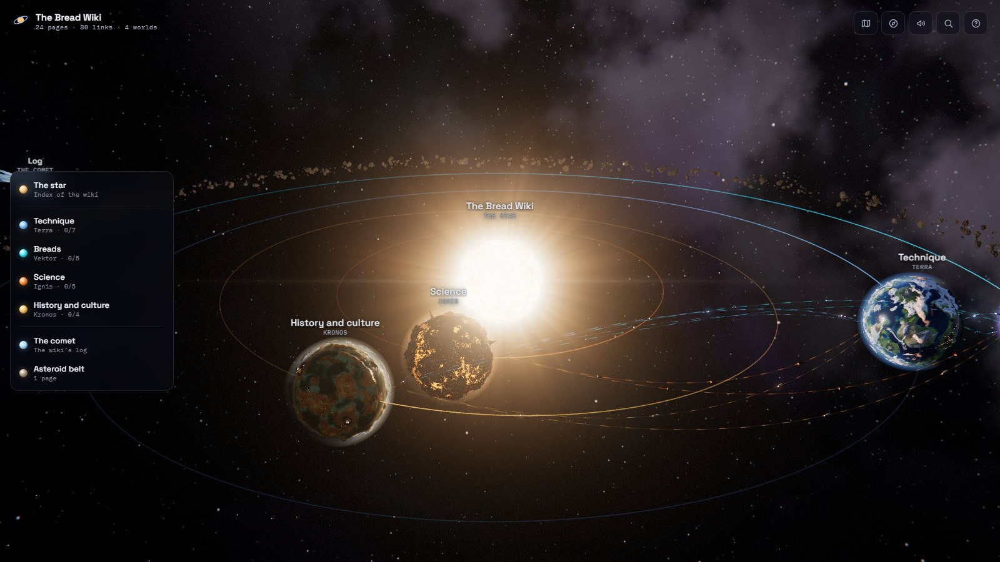
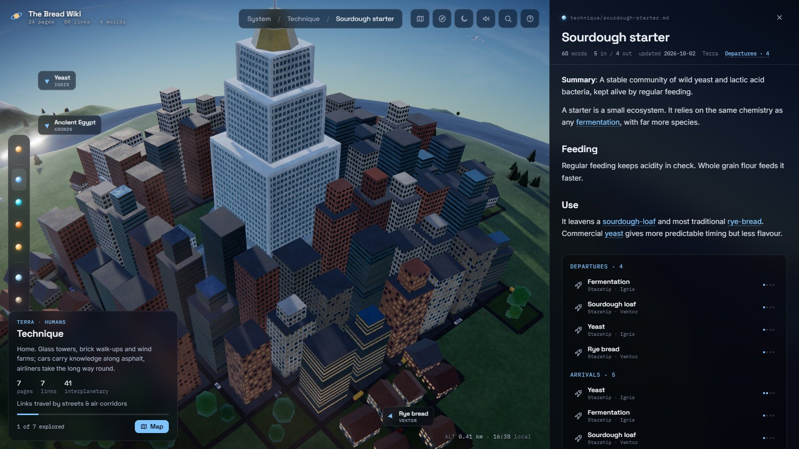
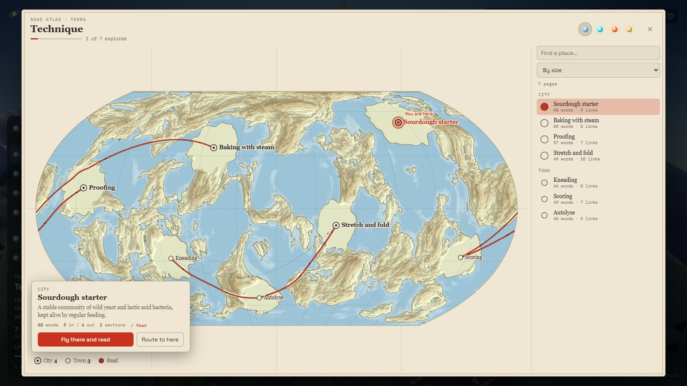
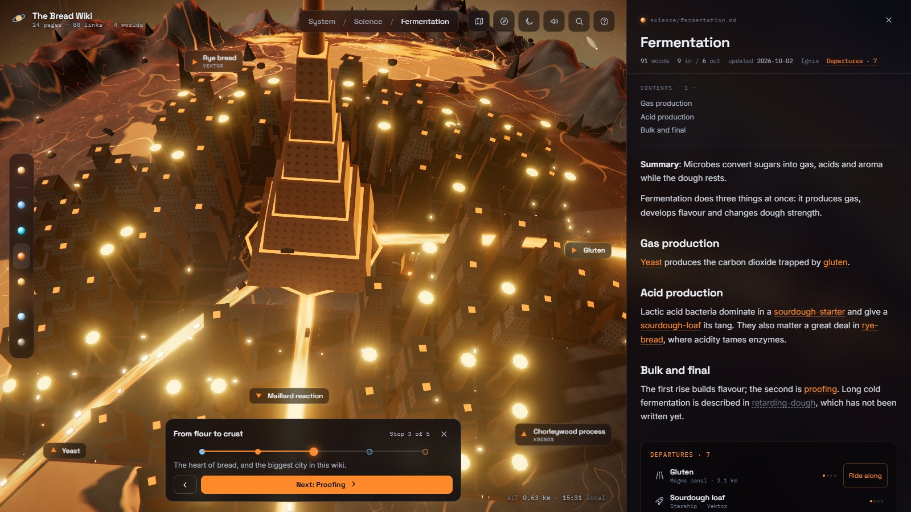
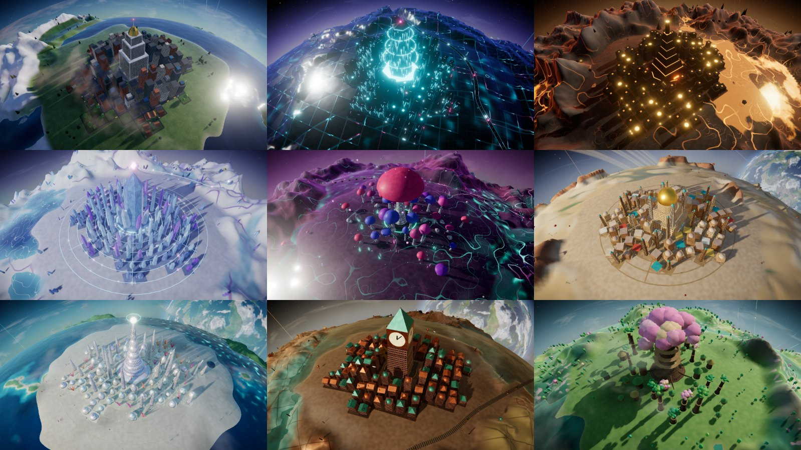
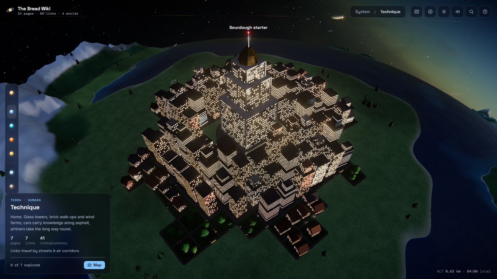

# Wikitary

**Explore any LLM wiki as a living solar system.** Topic clusters become planets, each inhabited by its own civilisation. Every Markdown page is a city, and the more the wiki leans on it the bigger and busier it gets. Every link is a road full of traffic. Zoom in continuously from deep space down to street level, unfold any world into a map, and read your wiki there.



Graph views show you that a wiki has structure. Wikitary gives you a place to walk around in it, and it still works as a map: the shape of the city is the shape of the knowledge.



## Try it

No install, no dependencies, no build step. Run this in the folder that contains your wiki:

```bash
npx github:SilasKa98/wikitary
```

Wikitary looks for a `wiki/` folder, otherwise it uses the current one. Pages can be nested in folders as deeply as you like. Your browser opens, and the map updates when your agent writes new pages.

To see it on the included demo wiki, clone this repo and run `npm run demo`.

## Reading the map

| In the wiki | On the map |
| --- | --- |
| Index page (`index.md`, `README.md`, …) | The star |
| Topic cluster | A planet with its own civilisation |
| Markdown page | A city around a landmark, from hamlet to metropolis |
| How linked and how long a page is | The size of its city: taller towers, denser blocks, more cars, people and aircraft |
| `##` headings | Buildings around the landmark; click to open that section |
| Link between pages on one topic | A road, rail or canal (nearby), or a flight route (long or tangled) |
| Direction and frequency of a link | Traffic runs in the link's direction, denser the more often it is mentioned |
| Link across topics | Starships on a route between planets |
| Link to a page that doesn't exist | A construction site next to the page that mentions it |
| Page nothing links to | An asteroid in the outer belt |
| `log.md` | A comet on a long ellipse |
| Page new or changed since your last visit | A tower crane beside its landmark, until you've read it |

This makes it useful for maintaining a wiki, too: asteroids and construction sites are your lint report.

## Finding your way

Press <kbd>K</kbd> and the globe unfolds into a map, drawn in the hand of the civilisation that lives there: a road atlas on Terra, a circuit schematic on Vektor, a brass engraving on Kronos. Every city sits where it really is, sized by importance, with its real roads and live traffic, including the far side you couldn't see. Beside it, a directory lists every place, and you can filter it or sort it by size, name or date. One click selects a city, a second flies you there. Tabs take you to the map of any other world.



**Departure boards.** The links of a page appear as a timetable: where they go, by which transport, and how often. Arrivals show what links here. While a page is open, its connections light up and the rest of the city steps back. Signposts at the edge of the screen point to linked places you can't see.

**Riding along.** Press *Ride along* on a departure, or click a passing vehicle, and follow the link at street level until it delivers you to the page at the other end.

**Routes.** Press <kbd>L</kbd> for the ship's log, and ask how two pages are connected. You get the shortest chain of links, with the direction of each one, and can travel it stop by stop.

**Plan your own expedition.** New to a topic and not sure where to begin? On the map, press <kbd>E</kbd> and pick any place. Everything one link away lights up, so you choose your next step knowing it connects, and you see the route grow along the real roads. Click somewhere further off and the route fills in the way there. Or ask for a route through a whole world or the entire wiki: it visits every place once, follows links wherever it can, and can skip what you've read. Each stop says how it connects to the one before, and an unfinished expedition waits for you until you come back.

**Expeditions.** Ready-made tours: the capital of every world, the biggest cities of one world, the pages with unfinished links, what changed since you were last here, and the most important places you haven't read. Your agent can write better ones, with a note at every stop:

```json
{
  "expeditions": [
    {
      "title": "Where to start",
      "description": "The five pages a newcomer should read first",
      "stops": [{ "page": "overview", "note": "Why this stop matters." }, "concepts/some-page.md"]
    }
  ]
}
```



**Logbook.** Pages you have opened are marked on the map, and each world shows how much of it you have explored. Nothing is hidden until you've read it: the log only adds to the map. It stays in your browser. When you come back after your agent has been at work, you'll find a crane at every page that changed.

## Reading

The text doesn't land on you all at once. Arriving at a city, you get its board: the summary, how long it takes to read, and the page's sections as a list of districts.

**Districts.** Open one and read just that part. The camera moves to its building, and the building lights up and shows its name. It also works the other way around: click a building and the text opens at its section. Sections you have spent time with keep their windows lit, by day as well, and each city's board tells you how far you've got. A section counts as read after it has been on screen for a while, so this measures attention, not understanding.

**Reading mode.** Press <kbd>T</kbd> and the board widens into a proper page, with a plan of the sections on one side, connections and sources on the other, and a strip of the living city beside it. Lines stay at a comfortable length, and the city carries on. Scrolling only lights up the building you've reached. The camera moves when you click a section, never just because you scrolled.

**Looking before you leap.** Hover over a link and you see what's there, while its city lights up. A click flies you there, and a button takes you back to the same line of the text you left.

**What Wikitary does to your text.** Nothing is changed on disk, and nothing is summarised by a model: it only recognises what's already written.

| In the Markdown | In the reader |
| --- | --- |
| `**Summary**: …` or `description` in the frontmatter | The opening lines of the board |
| `**Sources**: …`, `sources:` in the frontmatter | The Sources tab |
| `**Updated**: 2026-10-02` | The header |
| `(Source: a.pdf; b.md)` mid-sentence | Footnote marks, with the full text on hover and in the Sources tab |
| `> **Note:** …`, `> [!warning] …` | A plaque set off from the text |
| `## Heading` | A district that folds; pages under 180 words are simply shown in full |

These also work with the German labels, such as `**Zusammenfassung**`, `**Quellen**` and `(Quelle: …)`. Tables can be enlarged to the whole screen. Search finds text inside folded districts and opens them.

## The civilisations



| | Planet | People | Links travel by |
| --- | --- | --- | --- |
| `terra` | Earth-like; always the largest cluster | Humans | streets and air corridors |
| `vektor` | Black glass and circuit traces | The Collective | light traces and drones |
| `ignis` | Basalt and magma | The Forge-Clans | magma canals and cinder barges |
| `prisma` | Glaciers and auroras | The Lattice | ribbons of light |
| `myzel` | Bioluminescent fungal world | The Network | living veins and spore drift |
| `auris` | Ringed golden desert | The Sunweavers | caravan tracks and solar kites |
| `thalassa` | Ocean and coral atolls | The Pearlkeepers | sea-lanes and manta craft |
| `kronos` | Copper, brass and gears | The Clockmakers | brass rails and zeppelins |
| `sylva` | Soft green forest | The Treefolk | vine bridges and seed gliders |

All geometry and every texture is generated in code: there are no assets to download, and each wiki gets its own terrain, layout and night sky.

Planets turn, so cities light up at dusk. Press <kbd>N</kbd> to time-lapse to night.



## Commands

```bash
npx wikitary            # start the viewer, with live updates
npx wikitary build      # write one self-contained wikitary.html
npx wikitary inspect    # print which pages live on which planet
npx wikitary init       # add config, an npm script and an agent skill
```

| Option | |
| --- | --- |
| `--wiki <dir>` | Wiki folder (default: `./wiki` if present, otherwise `.`) |
| `--cluster <mode>` | `auto`, `graph`, `folders` or `frontmatter` |
| `--planets <n>` | Target number of planets |
| `--port <n>`, `--no-open` | Server options |
| `--out <file>` | Output file for `build` |
| `--json` | With `inspect`: print the whole graph |

These short forms work once Wikitary is installed in your wiki's project with `npm i -D github:SilasKa98/wikitary`.

The server listens on localhost only. `wikitary build` produces a file that holds the full text of your wiki, so share it only as widely as you would share the wiki itself. Images in your pages show up in the live viewer, but they are not embedded in the single file.

## Controls

| | |
| --- | --- |
| Click | Land on a world; open a building |
| Scroll | Zoom, from space to street level, and back out to the system |
| Drag | Move across the surface, or orbit the system |
| Right-drag or <kbd>Shift</kbd>-drag | Look around |
| <kbd>W</kbd> <kbd>A</kbd> <kbd>S</kbd> <kbd>D</kbd>, <kbd>Q</kbd> <kbd>E</kbd>, <kbd>R</kbd> <kbd>F</kbd> | Fly, turn, change altitude |
| <kbd>K</kbd> | Planet map, with a directory of every place |
| <kbd>E</kbd> on the map | Plan your own expedition, step by step |
| <kbd>T</kbd> | Reading mode: the whole page, wide |
| <kbd>L</kbd> | Ship's log: expeditions, route planner, what you've read |
| <kbd>,</kbd> <kbd>.</kbd> | Previous and next stop on a journey |
| Click a vehicle | Ride along to where its link leads |
| <kbd>/</kbd> or <kbd>Ctrl</kbd> <kbd>K</kbd> | Search titles, headings and full text |
| <kbd>N</kbd> / <kbd>M</kbd> / <kbd>?</kbd> | Day and night / ambient sound / legend |
| <kbd>Esc</kbd> | Get off, close the map, leave reading mode, close the page, or go up a level |

Following a link in the reader flies you to the page, across space if it lives on another planet. Every page has its own URL, so browser back and forward work and you can link to a page directly.

## How it fits your wiki

**Wiki formats.** Obsidian `[[wikilinks]]` with aliases and anchors, plain Markdown links, YAML frontmatter, and nested folders. Links resolve the way Obsidian does: relative path, root-relative path, unique file name, then alias or title, with the nearest page winning when a name is ambiguous. No page has to change for Wikitary, and it writes nothing into your wiki.

**Ignored by default.** `raw/`, `node_modules/`, `.obsidian/`, `.git/` and similar folders, and agent files such as `CLAUDE.md` and `AGENTS.md`.

**How pages become planets.** In `auto` mode, in order:

1. A `planet:` or `cluster:` field in the frontmatter of at least 70% of pages wins outright.
2. Otherwise a weighted Louvain clustering combines links (damped for hub pages), text similarity (TF-IDF), the headings of your index page, and folders.
3. Folders count only if they name topics (`physics/`, `music/`). Folders named after page types (`concepts/`, `entities/`, `sources/`) say nothing about the topic, so they are ignored.
4. Pages that name their planet themselves, with `planet:` or through `assign` in the config, then move there, and the rest stays where the clustering put it. The name can be a planet's generated name or the one you renamed it to. A name no planet has yet founds a new one.

The clustering compares words, not meaning: two pages about the same thing in different vocabulary may land on different planets. That is what step 4 is for.

The result is deterministic. Planets are named after index headings or folders where that fits, otherwise after their keywords.

**Do better with your agent.** Generated names are guesses, and your LLM has read the wiki. `wikitary init` installs a skill that lets it name the planets and match civilisations to topics:

```json
{
  "wiki": "wiki",
  "title": "My Research Notes",
  "planets": {
    "Economics & Music": { "name": "Harmonic Markets", "civ": "auris" }
  },
  "assign": { "notes/odd-one-out.md": "Harmonic Markets" },
  "exclude": ["drafts/**"],
  "cluster": { "mode": "auto", "count": 6 }
}
```

Save this as `wikitary.config.json` next to your wiki, or inside the wiki folder: a wiki opened with `--wiki` brings its own config along. Other options are `expeditions`, `include`, `star` and `comet` (paths of the pages to use for those), `lang` (`en` or `de`) and `port`.

## Performance

Wikitary needs WebGL 2 and is built for a dedicated GPU. It picks a quality level from your hardware, lowers its resolution if the frame rate drops, and holds worlds to a fixed vertex budget however large the wiki is. You can also choose a level with `?q=low`, `?q=medium` or `?q=high`.

A 1,500-page test wiki builds in about 20 seconds. Very large wikis get fewer neighbourhood buildings per page, and past the budget a page becomes a plain block, but every page stays on the map. A page shows 8 to 20 of its headings as buildings (5 on very large wikis), main headings first, and all of them in the reader and in search.

## Development

```bash
npm install
npm run dev      # rebuild the viewer on change
npm test         # parser, links, clustering, importance, logbook, routes, map projection, reader
npm run build    # bundle into dist/viewer (committed, so that installs need no build)
```

`src/core` is the dependency-free pipeline that turns a folder into a graph. `src/viewer` is the Three.js renderer. A new civilisation is a single file in `src/viewer/civs` with its terrain, shaders, buildings, vehicles and map style written as code: start from an existing one, then register it in `src/viewer/civs/index.js` and `CIV_IDS` in `src/core/pipeline.mjs`.

## License

[MIT](LICENSE). The viewer bundles three.js and marked (both MIT) and the fonts Inter, Space Grotesk and IBM Plex Mono (SIL Open Font License 1.1); their licenses are in [dist/viewer/THIRD_PARTY_LICENSES.txt](dist/viewer/THIRD_PARTY_LICENSES.txt).
